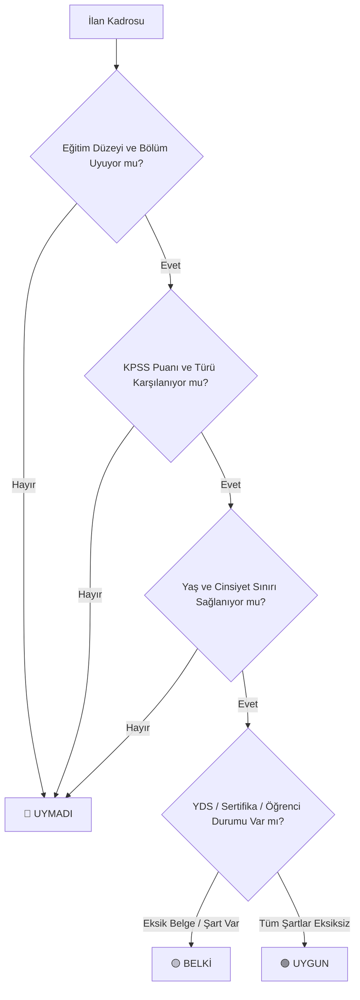

# 🏛️ Kamuİlan AI: Kamu İlan Takip ve Akıllı Eşleştirme Platformu

Türkiye'deki kamu personeli alım ilanlarını (**Resmî Gazete "Çeşitli İlanlar"** ve **Cumhurbaşkanlığı Kariyer Kapısı**) otomatik tarayan, karmaşık bürokratik metinleri ve PDF tablolarını **Google Gemini 2.5 Flash Yapay Zekası** ile yapılandırılmış JSON standartlarına dönüştüren ve adayların profillerine göre **"UYGUN (Yeşil) / BELKİ (Sarı) / UYMADI (Kırmızı)"** şeklinde anlık deterministik eşleştirme yapan **%100 Ücretsiz (0 TL) altyapılı** uçtan uca SaaS platformu.

---

## 💎 %100 ÜCRETSİZ (0 TL) ALTYAPI MİMARİSİ

| Servis / Katman | Kullanılan Teknoloji | Ücretsiz Katman Limiti (Free Tier) | Maliyet |
| :--- | :--- | :--- | :--- |
| **Frontend & API** | Next.js 14 (App Router, TypeScript) + Tailwind CSS | Vercel Hobby Tier (100 GB bant genişliği, sınırsız deploy) | **0 TL** |
| **Veritabanı & Auth** | Supabase (PostgreSQL 15 + RLS + GoTrue Auth) | 500 MB DB, 50.000 aktif kullanıcı/ay | **0 TL** |
| **Yapay Zeka (LLM)** | Google Gemini API (`gemini-2.5-flash` / `gemini-2.5-flash-lite`) | 15 RPM, 1.000.000 TPM, 1.500 İstek/Gün (Structured Output) | **0 TL** |
| **Otomasyon & Cron** | GitHub Actions (`.github/workflows/scrape.yml`) | Aylık 2.000 ücretsiz Linux çalışma dakikası (İhtiyaç: ~150 dk/ay) | **0 TL** |
| **Bildirim Dağıtımı**| Telegram Bot API (`api.telegram.org`) | Sınırsız anlık push bildirim, kota limiti yok | **0 TL** |

---

## 🚀 5 DAKİKADA CANLIYA ALMA REHBERİ

### Adım 1: Supabase Veritabanını Kurun
1. [supabase.com](https://supabase.com) adresine gidip ücretsiz bir hesap ve yeni proje ("kamu-ilan") oluşturun.
2. Sol menüden **SQL Editor** sekmesine tıklayın.
3. Projedeki [`supabase/schema.sql`](file:///c:/Users/enesg/Desktop/İş ilanı arama/supabase/schema.sql) dosyasının tüm içeriğini kopyalayıp editöre yapıştırın ve **Run** butonuna basın.
   * *Tüm tablolar (`departments`, `announcements`, `positions`, `user_profiles`), RLS güvenlik politikaları ve 100+ YÖK standart bölüm seed verisi tek tıkla yüklenir.*
4. **Project Settings -> API** bölümünden şu 3 anahtarı bir kenara not edin:
   * `Project URL`
   * `anon / public key`
   * `service_role key` (Gizli anahtar - Scraper ve Admin için)

---

### Adım 2: Google Gemini API Anahtarını Alın
1. [aistudio.google.com](https://aistudio.google.com) adresine Google hesabınızla giriş yapın.
2. **"Get API key"** butonuna basarak yeni bir ücretsiz API anahtarı oluşturun.
3. API anahtarını kopyalayın (`GEMINI_API_KEY`).

---

### Adım 3: Telegram Bildirim Botunu Oluşturun
1. Telegram uygulamasında [@BotFather](https://t.me/BotFather) botunu açın.
2. `/newbot` komutunu gönderin, botunuza bir ad ve kullanıcı adı (örn: `KamuIlanRobotu`) verin.
3. BotFather'ın verdiği **HTTP API Token**'ı kopyalayın (`TELEGRAM_BOT_TOKEN`).
4. Kendi oluşturduğunuz botunuza gidip **Başlat (`/start`)** butonuna basın.
5. Sayısal Chat ID'nizi öğrenmek için Telegram'da [@userinfobot](https://t.me/userinfobot) botuna `/start` atın; ID'nizi not edin.

---

### Adım 4: GitHub Actions Otomasyonunu Yapılandırın
Günde 2 kez (08:30 ve 18:30 TSİ) Resmî Gazete'yi otomatik tarayıp bildirim göndermesi için:
1. Bu projeyi kendi GitHub reponuza push edin (`git push origin main`).
2. GitHub reponuzda **Settings -> Secrets and variables -> Actions** yolunu izleyin.
3. **"New repository secret"** butonuna basarak aşağıdaki değerleri ekleyin:
   * `SUPABASE_URL`: Supabase Project URL
   * `SUPABASE_SERVICE_ROLE_KEY`: Supabase Service Role Secret Key
   * `GEMINI_API_KEY`: Google Gemini API Key
   * `TELEGRAM_BOT_TOKEN`: Telegram Bot Token
   * `NEXT_PUBLIC_APP_URL`: Vercel canlı site adresiniz (örn: `https://kamu-ilan.vercel.app`)

---

### Adım 5: Vercel Üzerinde Tek Tıkla Canlıya Alın
1. [vercel.com](https://vercel.com) paneline gidin, **"Add New Project"** diyerek GitHub reponuzu seçin.
2. **Environment Variables** bölümüne şunları ekleyin:
   * `NEXT_PUBLIC_SUPABASE_URL`: Supabase URL
   * `NEXT_PUBLIC_SUPABASE_ANON_KEY`: Supabase Anon Key
   * `SUPABASE_SERVICE_ROLE_KEY`: Supabase Service Role Key
   * `GEMINI_API_KEY`: Google Gemini API Key
   * `TELEGRAM_BOT_TOKEN`: Telegram Bot Token
   * `NEXT_PUBLIC_APP_URL`: Canlı alan adınız
3. **Deploy** butonuna basın. 1 dakika içerisinde siteniz yayında!

---

## 💻 YEREL GELİŞTİRME (LOCAL DEVELOPMENT)

### 1. Ortam Değişkenlerini Tanımlayın
Kök dizinde `.env.local` oluşturun:
```bash
cp .env.example .env.local
```
Supabase, Gemini ve Telegram anahtarlarınızı `.env.local` içerisine yapıştırın.

### 2. Frontend'i Başlatın
```bash
# Bağımlılıkları yükleyin
npm install

# Geliştirme sunucusunu çalıştırın
npm run dev
```
Tarayıcınızda [http://localhost:3000](http://localhost:3000) adresini açın.

### 3. Python Scraper ve AI Parser'ı Test Edin
```bash
# Sanal ortam oluşturup aktifleştirin
python -m venv venv
# Windows:
venv\Scripts\activate
# Linux/Mac:
source venv/bin/activate

# Bağımlılıkları yükleyin
pip install -r scraper/requirements.txt

# Veritabanına yazmadan test (Dry-run modu)
python scraper/main.py --dry-run --limit 2

# Tekil bir Resmî Gazete linkini Gemini ile test et
python scraper/main.py --url "https://www.resmigazete.gov.tr/ilanlar/eskiilanlar/2026/11/..."
```

---

## 🧠 AKILLI EŞLEŞTİRME MOTORU (MATCHING ENGINE)

Platform, adayın profil verileri ile ilanın kadro şartlarını deterministik olarak eşleştirir:



* **🟢 UYGUN (Yeşil Rozet):** Eğitim seviyesi, bölüm, KPSS puanı, yaş ve cinsiyet şartları tam tutuyor ve özel sertifika eksikliği yok.
* **🟡 BELKİ (Sarı Rozet):** Ana şartlar tutuyor fakat ilanda tecrübe/sertifika/ehliyet gibi ek şartlar aranıyor veya aday henüz öğrenci. Adaya tam olarak neyin kontrol edilmesi gerektiği Türkçe açıklanır.
* **🔴 UYMADI (Kırmızı Rozet):** Taban puan, eğitim seviyesi veya yaş sınırı kesin olarak aşılmışsa listelenir (varsayılan olarak gizlenebilir).

---

## 🛡️ KOTA KORUMASI VE GÜVENLİK
1. **Mükerrer Tarama Koruması:** Scraper, Resmî Gazete'yi tararken önce Supabase'deki `source_url` kayıtlarını çeker. Zaten taranmış ilanlar için Gemini API çağrısı **asla yapılmaz**; böylece günlük 1.500 istek kotası aylarca yeterli kalır.
2. **Akıllı Metin Kırpma (Chunking):** 30+ sayfalık Resmî Gazete eklerinde token aşımını önlemek için sadece "Başvuru Şartları", "Kadro Dağılım Tabloları" ve "Özel Şartlar" bölümleri ayıklanarak Gemini'ye beslenir.
3. **Row Level Security (RLS):** Supabase tablolarında RLS aktiftir. İlanlar herkese açık okunabilirken, kullanıcı profilleri yalnızca ilgili kullanıcının kendisi tarafından okunup değiştirilebilir.

---

## 📁 PROJE KLASÖR YAPISI

```text
kamu-ilan-takip/
├── .github/
│   └── workflows/
│       └── scrape.yml            # GitHub Actions Cron Job (08:30 & 18:30 TSİ)
├── app/
│   ├── api/
│   │   ├── admin/
│   │   │   ├── parse/route.ts    # Gemini AI İlan Ayrıştırma API'si
│   │   │   └── save/route.ts     # İlan Kaydetme & Bildirim Dağıtma
│   │   ├── departments/route.ts  # YÖK Bölüm Otomatik Tamamlama
│   │   └── test-telegram/route.ts# Telegram Test Bildirimi API'si
│   ├── ilan/
│   │   └── [id]/page.tsx         # İlan Detayı & Şart Karşılaştırma Matrisi
│   ├── profil/
│   │   └── page.tsx              # 1 Dakikalık Profil ve Kriter Sihirbazı
│   ├── admin/
│   │   └── page.tsx              # Manuel İlan Ekleme & AI Test Paneli
│   ├── giris/
│   │   └── page.tsx              # Supabase Auth Giriş & Kayıt Ekranı
│   ├── globals.css               # Tailwind & Özel Animasyon Stilleri
│   ├── layout.tsx                # Kök Layout & Navbar / Footer Entegrasyonu
│   └── page.tsx                  # Ana Sayfa / Filtrelenebilir İlan Akışı
├── components/
│   ├── Navbar.tsx                # Responsive Gezinme Çubuğu & Profil Rozeti
│   └── Footer.tsx                # Açık Kaynak & Free Tier Bilgi Altlığı
├── lib/
│   ├── context/
│   │   └── user-profile-context.tsx # Profil State & LocalStorage / Supabase Senkronizasyonu
│   ├── supabase/
│   │   ├── client.ts             # Browser Supabase İstemcisi
│   │   └── admin.ts              # Service Role İstemcisi (Admin / API)
│   ├── matcher.ts                # Deterministik Eşleştirme Motoru (TypeScript)
│   └── sample-data.ts            # Başlangıç Örnek İlanları & Popüler Bölümler
├── scraper/
│   ├── ai_parser.py              # Google Gemini 2.5 Flash Structured Output Ayrıştırıcısı
│   ├── config.py                 # Çevre Değişkenleri & İstemci Başlatıcılar
│   ├── matcher.py                # Deterministik Eşleştirme Motoru (Python)
│   ├── notifier.py               # Telegram Bot API Anlık Bildirim Motoru
│   ├── resmi_gazete.py           # Resmî Gazete Çeşitli İlanlar & PDF Metin Çıkarıcı
│   ├── main.py                   # Scraper CLI Orkestratörü
│   └── requirements.txt          # Python Bağımlılıkları
├── supabase/
│   └── schema.sql                # PostgreSQL Şeması, İndeksler, RLS ve 100+ Bölüm Seed'i
├── .env.example                  # Çevre Değişkenleri Şablonu
├── tailwind.config.js            # Tailwind Tema Yapılandırması
├── tsconfig.json                 # TypeScript Ayarları
└── README.md                     # Kapsamlı Dokümantasyon
```

---

## ⚖️ LİSANS
Bu proje MIT lisansı altında açık kaynak olarak yayımlanmıştır. Kamu yararına geliştirilmiştir.
